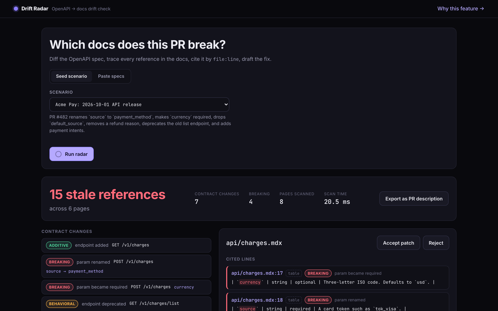
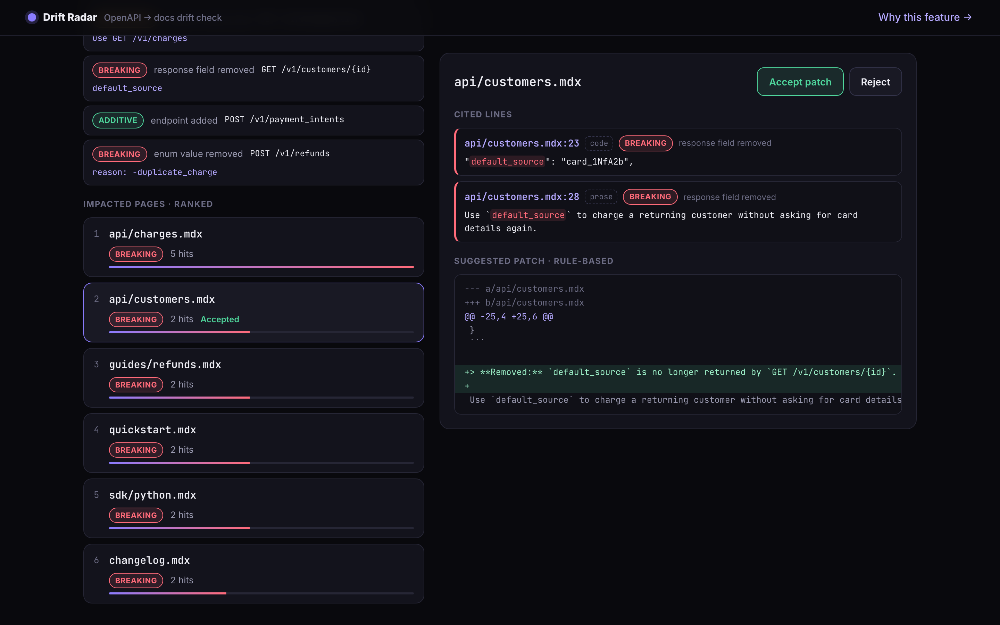
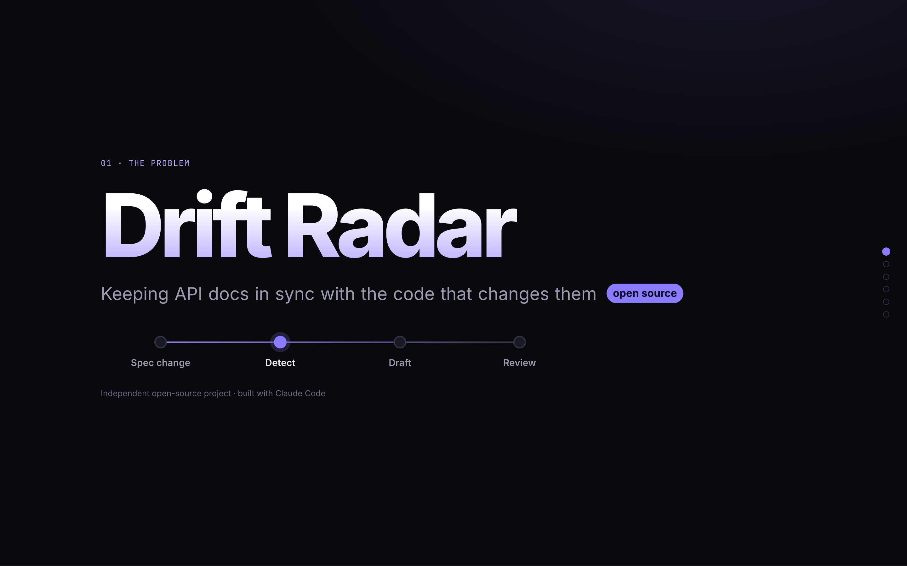
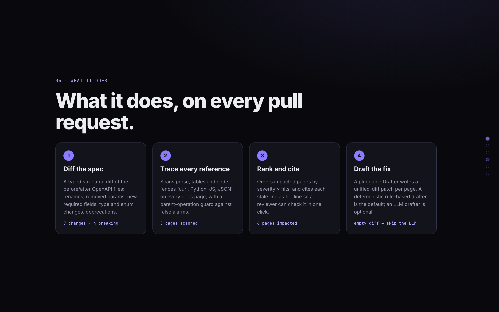

# OpenAPI Drift Radar

**Find every docs line that an API change makes stale, cite it by `file:line`, and draft the fix, before an LLM agent runs.**

  

> An independent open-source project about keeping API docs in sync with code. The seed data uses a fictional API, "Acme Pay".

---

## The problem: API docs drift away from the code

Code now ships faster than anyone can update the docs. AI coding assistants push teams toward roughly 10 PRs per developer per week, and a growing share of docs traffic comes from AI agents that act on whatever the docs say. When a parameter is renamed in `openapi.yaml`, a dozen lines across the quickstart, the API reference, SDK pages and the changelog go silently wrong. A stale parameter is no longer a cosmetic bug: it produces broken integrations and wrong answers from LLMs.

Teams that use AI docs-maintenance tools in this space say the value they notice most is when the tool catches "old spots we'd missed." Industry surveys report that more than half of API teams still ship inconsistent docs. Most tools answer "does this PR need a docs update, and where?" by asking an LLM to read the PR and search the docs. That is slow, costs tokens on every PR, and can quietly miss pages.

## What I built and why

**The feature.** OpenAPI Drift Radar is a deterministic, cited first pass that runs on every PR before any LLM:

1. It computes a **typed structural diff** of the before and after OpenAPI specs: removed or renamed endpoints and params, params that became required, type changes, removed enum values, removed response fields, deprecations and additions. Each change has a severity (`breaking`, `behavioral` or `additive`).
2. It **scans every docs page** for references to the changed items in prose, tables and code fences (curl, Python, JS, JSON). Templated paths like `/v1/customers/{id}` match literal ids like `/v1/customers/cus_9s6X`. Bare param names only count on pages that also reference the parent operation, which keeps false positives out. In the seed run, `faq.md`'s "open source" and the webhook payload's `source` field are correctly ignored.
3. It **ranks** the impacted pages by severity × hits and **drafts a unified-diff patch** for each one through a `Drafter` interface.
4. If the spec diff is empty, it returns `skip_llm: true`, so a no-op PR costs **zero LLM tokens**.

**Why this feature.** Detection is the first step of any docs-maintenance loop (change → detect → draft → review), and every later step depends on it: a page that is never flagged is never fixed. A structural spec diff is cheap, explainable and checkable, and every hit carries a `file:line` citation a reviewer can verify in one click. When the diff is non-empty, an LLM agent can still do the drafting, but it starts from the exact pages and lines instead of searching for them.

**Alternative considered: a risk-ranked review queue** that sorts suggested doc edits by customer impact. It lost because it only proves its value with real suggestion and traffic data, so a demo would be mostly invented. Drift Radar's inputs (a spec plus a docs folder) are public, so every number it shows is real.

**Seed result** (`acme-payments`): **15 stale references across 6 of 8 pages**, from 7 contract changes (4 breaking). Every reference is cited by `file:line` and has a drafted patch, and the scan takes a few milliseconds.

## Screenshots

| Radar: impacted pages | Radar: cited lines and drafted patch |
|---|---|
|  |  |
| **`/story`: the problem** | **`/story`: what it does** |
|  |  |

## Quickstart

Requirements: [uv](https://docs.astral.sh/uv/), Node 20+.

```bash
uv sync && cd web && npm i && cd .. && make dev
```

Then open **http://localhost:5173** (the radar) and **http://localhost:5173/story** (the animated explainer). `/story?autoplay=1` advances one scene every 4 seconds for hands-free recording, and `?reduced=1` renders every scene in its final state.

To run a single-process production build, use `make serve`, then open http://127.0.0.1:5001.

## CLI and GitHub Action

```bash
uv run python -m radar.cli \
  --before seed/acme-payments/openapi.before.yaml \
  --after  seed/acme-payments/openapi.after.yaml \
  --docs   seed/acme-payments/docs \
  --format md          # or json; add --fail-on-breaking to gate CI
```

The Markdown output is a ready-to-post PR comment. [`examples/github-action/drift-radar.yml`](examples/github-action/drift-radar.yml) shows how to run the radar on every PR that touches the spec and post a sticky comment. It is an example only and lives outside `.github/workflows`, so it never runs here. Copy it into your API repo's `.github/workflows/` to use it.

## API

| Route | What it does |
|---|---|
| `GET /api/health` | Liveness check |
| `GET /api/scenarios` | Lists the seed scenarios |
| `POST /api/analyze` | Takes `{scenario}` or `{before_spec, after_spec, docs: [{path, content}]}` and returns `{changes, impacts, summary}` |
| `GET /api/analyze?scenario=…` | Same as the POST, for a seed scenario |

Malformed YAML returns 400 and payloads over 2 MB return 413. Responses are validated with pydantic v2.

## Architecture

```
radar/                pure-Python core (no Flask imports)
  models.py           pydantic: Change, Severity, Hit, Impact, Report
  spec_loader.py      YAML/JSON loading + local $ref resolution
  differ.py           diff_specs(before, after) -> list[Change]   (incl. rename heuristic)
  scanner.py          scan_docs(docs, changes) -> list[Hit]       (code/table/prose aware, parent-op guard)
  ranker.py           rank(hits, changes) -> list[Impact]         (severity weight x hits, ties by path)
  drafter.py          Drafter protocol, RuleBasedDrafter, AnthropicDrafter, make_patch/apply_patch
  report.py           analyze(...) -> Report, to_markdown(report), seed scenarios
  metrics.py          writes web/src/story/story-metrics.json from the real seed run
  cli.py
server/app.py         Flask factory: /api/*, serves web/dist in production
seed/                 acme-payments (8 docs pages, expected.json golden) + noop
web/                  React 19 + TypeScript + Vite + motion: Radar page and /story
```

**How it fits a docs pipeline:** Drift Radar runs first on each PR. An empty diff skips any LLM agent entirely. Otherwise the agent receives the ranked pages, the exact cited lines and a deterministic starter patch as context, which narrows its research step and makes "every relevant section was updated" checkable. `AnthropicDrafter` is the optional LLM drafter. It is used only when `ANTHROPIC_API_KEY` is set (install it with `uv sync --extra llm`) and falls back to the rule-based drafter on any error.

## Stack

A React frontend over a Python/Flask backend:

- **Backend:** Python 3.11, Flask 3, pydantic v2, PyYAML, with uv, ruff and pytest.
- **Frontend:** React 19, TypeScript, Vite, React Router, `motion` (`motion/react`), with Vitest and Testing Library.
- **Data:** seed fixtures on disk. Postgres and pgvector aren't needed for the demo.

## Tests

```bash
make test     # pytest (with coverage) + vitest
make lint     # ruff + tsc + eslint
```

- **pytest:** ~100 tests at about 96% coverage on `radar/` and `server/`. They include one test per change kind, the rename heuristic and its negative cases, `$ref` resolution, templated-path matching, fence/table/prose classification, the false-positive guard, deterministic ranking, patches that apply cleanly and re-scan to zero, a golden test against `seed/acme-payments/expected.json`, the API (200/400/404/413), the CLI, and a check that the story's numbers match the real output.
- **vitest:** components, the Radar page flow (run, select, accept/reject, export, no-op, errors), and the Story page (all six scenes, real numbers, reduced-motion final state, autoplay).

## Limitations and next steps

- Rename detection is heuristic: one removed param and one added param in the same operation with the same `in` and type. Ambiguous cases are reported as remove plus add.
- Only local `$ref`s (`#/components/...`) are resolved, and only JSON request and response bodies are diffed.
- Next steps: GraphQL and SDK-surface diffs, and pgvector semantic matching for prose that paraphrases a parameter instead of naming it.

## Configuration

Copy `.env.example` to `.env` if you want the optional LLM drafter. Never commit `.env`.

```
ANTHROPIC_API_KEY=   # optional
ANTHROPIC_MODEL=     # optional, defaults to claude-opus-5-5
```

---

Built with [Claude Code](https://claude.com/claude-code).
